# Exception and Validation Class Diagram — GameZone Unicesar

Exception hierarchy, validators and their integration with the existing services,
repositories and the console menu (exam Requerimiento 6). Existing classes are shown only with
the members involved in the integration.

## Exception hierarchy and validators

```mermaid
classDiagram

    %% ===== EXCEPTIONS (transversal layer) =====
    class RuntimeException {
        <<external>>
    }
    class GameZoneException {
        <<abstract>>
        -errorCode: String
        +GameZoneException(message: String)
        +GameZoneException(message: String, errorCode: String)
        +GameZoneException(message: String, errorCode: String, cause: Throwable)
        +getErrorCode() String
    }
    class ResourceNotFoundException {
        -resourceType: String
        -resourceId: String
        +ResourceNotFoundException(resourceType: String, resourceId: String)
        +ResourceNotFoundException(message: String)
        +getResourceType() String
        +getResourceId() String
    }
    class BusinessRuleException {
        +BusinessRuleException(message: String)
        +BusinessRuleException(message: String, errorCode: String)
    }
    class InvalidDataException {
        -fieldName: String
        -problemDescription: String
        +InvalidDataException(fieldName: String, problemDescription: String)
        +InvalidDataException(message: String)
        +getFieldName() String
        +getProblemDescription() String
    }
    class PersistenceException {
        +PersistenceException(message: String, cause: Throwable)
        +PersistenceException(fileName: String, operation: String, cause: Throwable)
        +PersistenceException(message: String)
    }

    RuntimeException <|-- GameZoneException
    GameZoneException <|-- ResourceNotFoundException
    GameZoneException <|-- BusinessRuleException
    GameZoneException <|-- InvalidDataException
    GameZoneException <|-- PersistenceException

    %% ===== VALIDATION LAYER =====
    class ProductValidator {
        +validateProductData(id: String, title: String, price: double, stock: int)$ void
        +validateRequiredField(fieldName: String, value: String)$ void
        +validateUniqueProduct(existing: List~Product~, newId: String)$ void
        +validateProductExists(product: Product, productId: String)$ void
        +validateStockAvailability(product: Product, requestedQuantity: int)$ void
        +validateNonNegativeStock(quantity: int)$ void
    }
    class PersonValidator {
        +validatePersonData(id: String, firstName: String, lastName: String, phone: String, email: String)$ void
        +validatePersonExists(person: Person, personId: String)$ void
        +validateUniquePerson(existing: List~Person~, newId: String)$ void
    }
    class SaleValidator {
        +validateProductIdsNotEmpty(productIds: List~String~)$ void
        +validateSaleData(customer: Customer, seller: Seller, products: List~Product~)$ void
        +validateSaleExists(sale: Sale, saleId: String)$ void
    }

    ProductValidator ..> InvalidDataException : throws
    ProductValidator ..> BusinessRuleException : throws
    ProductValidator ..> ResourceNotFoundException : throws
    PersonValidator ..> InvalidDataException : throws
    PersonValidator ..> BusinessRuleException : throws
    PersonValidator ..> ResourceNotFoundException : throws
    SaleValidator ..> InvalidDataException : throws
    SaleValidator ..> BusinessRuleException : throws
    SaleValidator ..> ResourceNotFoundException : throws

    %% ===== SERVICE LAYER (existing, refactored) =====
    class ProductService {
        +registerVideoGame(...) void
        +registerConsole(...) void
        +updateStock(productId: String, quantity: int) void
        +restoreStock(productId: String, quantity: int) void
    }
    class PersonService {
        +registerCustomer(id: String, firstName: String, lastName: String, phone: String, email: String) void
    }
    class SaleService {
        +registerSale(customerId: String, sellerId: String, productIds: List~String~, extendedWarrantyIds: List~String~) Sale
    }

    ProductService ..> ProductValidator : validates with
    PersonService ..> PersonValidator : validates with
    SaleService ..> SaleValidator : validates with
    SaleService ..> PersonValidator : validates with
    SaleService ..> ProductValidator : validates with
    SaleService ..> BusinessRuleException : throws

    %% ===== PERSISTENCE LAYER (existing, refactored) =====
    class ProductRepository
    class PersonRepository
    class SaleRepository

    ProductRepository ..> PersistenceException : wraps IOException
    PersonRepository ..> PersistenceException : wraps IOException
    SaleRepository ..> PersistenceException : wraps IOException

    ProductService --> ProductRepository
    PersonService --> PersonRepository
    SaleService --> SaleRepository

    %% ===== USER INTERFACE =====
    class ConsoleMenu {
        -runGuarded(action: Runnable) void
    }
    class Main {
        +main(args: Array~String~)$ void
    }

    ConsoleMenu ..> ResourceNotFoundException : catches
    ConsoleMenu ..> BusinessRuleException : catches
    ConsoleMenu ..> InvalidDataException : catches
    ConsoleMenu ..> PersistenceException : catches
    ConsoleMenu --> ProductService
    ConsoleMenu --> PersonService
    ConsoleMenu --> SaleService
    Main ..> PersistenceException : catches at startup
    Main --> ConsoleMenu
```

## How the pieces work together

- **Services call validators first.** Each business operation in `ProductService`,
  `PersonService` and `SaleService` validates its input through the static methods of the
  validator of its module before it changes anything. Rules that need stored data receive it as
  a parameter (`existing`, `product`, `person`), so the validators never touch the persistence
  package.
- **Validators throw typed exceptions.** A blank field or a negative stock raises
  `InvalidDataException`, a duplicated identifier or an insufficient stock raises
  `BusinessRuleException`, and a missing product, customer or seller raises
  `ResourceNotFoundException`. `SaleService` also raises `BusinessRuleException` itself when an
  extended warranty is requested for an item that is not a console.
- **Repositories translate file errors.** The three repositories catch `IOException` and
  rethrow `PersistenceException` with the file name and the operation in the message, keeping
  the original exception as the cause.
- **The menu reports each category differently.** `ConsoleMenu.runGuarded` has one `catch`
  block per exception type, from the most specific to the most general, and every menu action
  runs through it. `Main` shows the persistence message when a data file cannot be read at
  startup, before the menu exists.

## Scope note

Only the product, person and sale modules were migrated to the new exceptions, as the
requirement asks. `AccessoryService`, `PromotionService`, `ReturnService` and `WarrantyService`
still throw `IllegalArgumentException` and `IllegalStateException`; `runGuarded` keeps a last
`catch` block for them so the menu behaves as before for those modules.
