# GRASP Class Diagram — Before and After — GameZone Unicesar

Class diagrams of the correction of the GRASP audit (exam Requerimiento 7). They show the classes involved in the
violations of `docs/grasp-audit/consolidated-audit.md`, with the attributes, methods and relations that matter for those
violations. Each note names the identifiers of the violations related to the class.

## Before (start of Phase 2, `develop` at `1a27972`)

```mermaid
classDiagram

    %% ===== MODEL =====
    class Product {
        <<abstract>>
        -stock: int
        +getStock() int
        +updateStock(quantity: int) void
        +getCategory() String
    }
    class VideoGame {
        +getCategory() String
    }
    class Console {
        +getCategory() String
    }
    class Accessory {
        -compatibleConsoleIds: List~String~
        +isCompatibleWith(consoleId: String) boolean
        +getCategory() String
    }
    class Controller
    class Cable
    class Memory
    class Sale {
        -products: List~Product~
        -appliedPromotionName: String
        -discountAmount: double
        +getProducts() List~Product~
        +setAppliedPromotionName(name: String) void
        +setDiscountAmount(amount: double) void
        +calculateTotal() double
        +generateReceipt() String
    }
    class Warranty {
        <<abstract>>
        +getDurationInMonths() int
        +getWarrantyType() String
        +getAdditionalCost() double
    }
    class BasicWarranty
    class ExtendedWarranty
    class Promotion {
        <<abstract>>
        +calculateDiscount(products: List~Product~) double
    }
    class CategoryDiscount {
        -targetCategory: String
        -belongsToTargetCategory(product: Product) boolean
    }

    Product <|-- VideoGame
    Product <|-- Console
    Product <|-- Accessory
    Accessory <|-- Controller
    Accessory <|-- Cable
    Accessory <|-- Memory
    Warranty <|-- BasicWarranty
    Warranty <|-- ExtendedWarranty
    Promotion <|-- CategoryDiscount
    Sale o-- Product
    Warranty --> Sale
    Warranty --> Product

    %% ===== SERVICES =====
    class ProductService {
        -videoGames: List~VideoGame~
        -consoles: List~Console~
        +registerVideoGame(...) void
        +registerConsole(...) void
        +listAllProducts() List~Product~
        +restoreStock(productId: String, quantity: int) void
    }
    class AccessoryService {
        +restoreStock(accessoryId: String, quantity: int) void
        -matchesType(accessory: Accessory, type: String) boolean
        -validateCommonFields(title: String, price: double, stock: int) void
    }
    class SaleService {
        -resolveItem(itemId: String) Product
        -discountStock(item: Product) void
        -applyBestPromotion(sale: Sale) void
        -validateExtendedWarrantyRequest(...) Set~String~
        -assignWarranties(sale: Sale, ids: Set~String~) double
    }
    class ReturnService {
        -personService: PersonService
        -resolveItem(itemId: String) Product
        -restoreStock(item: Product, quantity: int) void
        +registerReturn(saleId: String, productIds: List~String~) Return
        +calculateMonthlySales(month: int, year: int) double
        +calculateMonthlyReturns(month: int, year: int) double
        +generateMonthlyBalance(month: int, year: int) double
    }
    class WarrantyService {
        +findWarrantyByProduct(productId: String, saleId: String) Warranty
        +cancelWarranties(productId: String, saleId: String) double
        -validateWarrantyRequest(product: Product, sale: Sale, startDate: LocalDate) void
        -rebuildWarranties() List~Warranty~
    }
    class PromotionService {
        -normalizeCategory(category: String) String
        -validateCommonFields(...) void
    }

    SaleService --> ProductService
    SaleService --> AccessoryService
    SaleService --> WarrantyService
    SaleService --> PromotionService
    ReturnService --> SaleService
    ReturnService --> ProductService
    ReturnService --> AccessoryService
    ReturnService --> WarrantyService
    WarrantyService --> ProductService

    %% ===== PERSISTENCE =====
    class ProductRepository {
        +saveAllVideoGames(videoGames: List~VideoGame~) void
        +saveAllConsoles(consoles: List~Console~) void
        -writeList(...) void
        -readList(...) List
    }
    class SaleRepository {
        -writeList(...) void
        -readList(...) List
        -ProductDeserializer
        -LocalDateAdapter
    }
    class ReturnRepository {
        -writeList(...) void
        -readList(...) List
        -ProductDeserializer
        -LocalDateAdapter
    }
    class PromotionRepository {
        -writeList(...) void
        -readList(...) List
        -LocalDateAdapter
    }
    class PersonRepository {
        -writeList(...) void
        -readList(...) List
    }
    class AccessoryRepository {
        -writeList(...) void
        -readList(...) List
    }
    class WarrantyRepository {
        +saveAll(records: List~WarrantyRecord~) void
        +loadAll() List~WarrantyRecord~
    }

    ProductService --> ProductRepository
    SaleService --> SaleRepository
    ReturnService --> ReturnRepository
    PromotionService --> PromotionRepository
    AccessoryService --> AccessoryRepository
    WarrantyService --> WarrantyRepository

    %% ===== USER INTERFACE =====
    class ConsoleMenu {
        923 lines and 48 methods
        +start() void
        -askExtendedWarranties(itemIds: List~String~) List~String~
        -printSale(sale: Sale) void
        -monthlyBalance() void
        -runGuarded(action: Runnable) void
        -readText(prompt: String) String
        -readInt(prompt: String) int
    }
    class Main {
        +main(args: String[]) void
        -createMenu() ConsoleMenu
    }

    ConsoleMenu --> ProductService
    ConsoleMenu --> SaleService
    ConsoleMenu --> ReturnService
    ConsoleMenu --> AccessoryService
    ConsoleMenu --> WarrantyService
    ConsoleMenu --> PromotionService
    Main --> ConsoleMenu

    %% ===== NOTES WITH THE VIOLATIONS =====
    note for Product "V-01 stock arithmetic done outside. V-03 no supportsWarranty. V-17 category text"
    note for VideoGame "V-17 category text repeated"
    note for Console "V-03 warranty known by type checks. V-17 category text repeated"
    note for Accessory "V-15 no type method. V-17 category text repeated"
    note for Sale "V-06 no hasDiscount. V-07 promotion set by the service. V-12 no countUnits or contains"
    note for Warranty "V-16 type code decided by instanceof in the service"
    note for CategoryDiscount "V-10 instanceof Accessory"
    note for ProductService "V-01 restoreStock. V-09 two concrete lists. V-11 one method per subtype"
    note for AccessoryService "V-01 restoreStock. V-15 matchesType by instanceof. V-19 inline validation"
    note for SaleService "V-01 discountStock. V-02 resolveItem and discountStock by type. V-03 instanceof Console. V-07 applyBestPromotion"
    note for ReturnService "V-02 duplicated mediation. V-03 instanceof Console. V-12 counts units. V-13 unused personService. V-14 monthly balance"
    note for WarrantyService "V-03 instanceof Console. V-12 searches the sale products. V-16 instanceof ExtendedWarranty"
    note for PromotionService "V-17 categories defined twice. V-19 inline validation"
    note for ProductRepository "V-09 two lists. V-18 file access copy"
    note for SaleRepository "V-08 duplicated adapters. V-18 file access copy"
    note for ReturnRepository "V-08 duplicated adapters. V-18 file access copy"
    note for PromotionRepository "V-08 duplicated adapter. V-18 file access copy"
    note for PersonRepository "V-18 file access copy"
    note for AccessoryRepository "V-18 file access copy"
    note for WarrantyRepository "V-18 file access copy"
    note for ConsoleMenu "V-04 domain rule. V-05 eight modules in one class. V-06 repeated discount rule. V-11 and V-14 calls"
    note for Main "V-02 V-13 V-14 wiring"
```

## After (end of Phase 2)

*To be completed by the Technical Lead when the last correction is merged: the same classes, together with the classes,
interfaces and abstractions that the correction creates (`InventoryService`, `MonthlyBalanceService`, `JsonFileStore`,
`ProductFactory`, `ProductCategory`, `AccessoryValidator`, `PromotionValidator`, the shared persistence adapters, and the
menu classes that replace `ConsoleMenu`), with the identifiers of the violations in the notes.*
