# GRASP Class Diagram — Before and After — GameZone Unicesar

Class diagrams of the correction of the GRASP audit (exam Requerimiento 7). They show the classes involved in the
violations of `docs/grasp-audit/consolidated-audit.md`, with the attributes, methods and relations that matter for those
violations. Each note names the identifiers of the violations related to the class.

## Before (start of Phase 2, `develop` at `1a27972`)

## After (end of Phase 2)

```mermaid
classDiagram

    %% ===== MODEL =====
    class Product {
        <<abstract>>
        -stock: int
        +getStock() int
        +updateStock(quantity: int) void
        +increaseStock(quantity: int) void
        +decreaseStock(quantity: int) void
        +supportsWarranty() boolean
        +getCategory() String
    }
    class ProductCategory {
        <<enumeration>>
        VIDEOGAME
        CONSOLE
        ACCESSORY
        +isValid(name: String)$ boolean
    }
    class VideoGame {
        +getCategory() String
    }
    class Console {
        +supportsWarranty() boolean
        +getCategory() String
    }
    class Accessory {
        <<abstract>>
        -compatibleConsoleIds: List~String~
        +getAccessoryType() String
        +isCompatibleWith(consoleId: String) boolean
        +getCategory() String
    }
    class Controller
    class Cable
    class Memory
    class Sale {
        -products: List~Product~
        -appliedPromotionName: String
        -discountAmount: double
        +applyPromotion(promotion: Promotion) void
        +hasDiscount() boolean
        +countUnits(productId: String) int
        +contains(productId: String) boolean
        +calculateTotal() double
        +generateReceipt() String
    }
    class Warranty {
        <<abstract>>
        +getDurationInMonths() int
        +getTypeCode() String
        +getAdditionalCost() double
    }
    class BasicWarranty
    class ExtendedWarranty
    class Promotion {
        <<abstract>>
        +calculateDiscount(products: List~Product~) double
    }
    class CategoryDiscount {
        -targetCategory: String
        -belongsToTargetCategory(product: Product) boolean
    }

    Product <|-- VideoGame
    Product <|-- Console
    Product <|-- Accessory
    Accessory <|-- Controller
    Accessory <|-- Cable
    Accessory <|-- Memory
    Warranty <|-- BasicWarranty
    Warranty <|-- ExtendedWarranty
    Promotion <|-- CategoryDiscount
    Sale o-- Product
    Warranty --> Sale
    Warranty --> Product
    VideoGame ..> ProductCategory
    Console ..> ProductCategory
    Accessory ..> ProductCategory

    %% ===== VALIDATION =====
    class AccessoryValidator {
        +validateCommonData(...)$ void
        +validateCableData(...)$ void
        +validateMemoryData(...)$ void
    }
    class PromotionValidator {
        +validateCommonData(...)$ void
        +validatePercentage(percentage: double)$ void
        +normalizeCategory(category: String)$ String
    }

    %% ===== SERVICES =====
    class ProductService {
        -products: List~Product~
        +registerProduct(product: Product) void
        +listAllProducts() List~Product~
        +decreaseStock(productId: String, quantity: int) void
        +restoreStock(productId: String, quantity: int) void
    }
    class ProductFactory {
        +createVideoGame(...)$ VideoGame
        +createConsole(...)$ Console
    }
    class AccessoryService {
        +decreaseStock(accessoryId: String, quantity: int) void
        +restoreStock(accessoryId: String, quantity: int) void
        +listAccessoriesByType(type: String) List~Accessory~
    }
    class InventoryService {
        +findItem(itemId: String) Product
        +decreaseStock(itemId: String, quantity: int) void
        +restoreStock(itemId: String, quantity: int) void
    }
    class SaleService {
        +registerSale(...) Sale
        +findItemsEligibleForExtendedWarranty(itemIds: List~String~) List~Product~
    }
    class ReturnService {
        +registerReturn(saleId: String, productIds: List~String~) Return
    }
    class MonthlyBalanceService {
        +calculateMonthlySales(month: int, year: int) double
        +calculateMonthlyReturns(month: int, year: int) double
        +generateMonthlyBalance(month: int, year: int) double
    }
    class WarrantyService {
        +findWarrantyByProduct(productId: String, saleId: String) Warranty
        +cancelWarranties(productId: String, saleId: String) double
    }
    class PromotionService

    ProductService ..> ProductCategory
    PromotionService ..> ProductCategory
    PromotionService ..> PromotionValidator
    AccessoryService ..> AccessoryValidator
    ProductFactory ..> Product
    InventoryService --> ProductService
    InventoryService --> AccessoryService
    SaleService --> InventoryService
    SaleService --> WarrantyService
    SaleService --> PromotionService
    ReturnService --> SaleService
    ReturnService --> InventoryService
    ReturnService --> WarrantyService
    MonthlyBalanceService --> SaleService
    MonthlyBalanceService --> ReturnService
    WarrantyService --> ProductService

    %% ===== PERSISTENCE =====
    class JsonFileStore {
        ~write(fileName: String, items: List, type: Type) void
        ~read(fileName: String, type: Type) List
    }
    class LocalDateAdapter
    class ProductDeserializer
    class ProductRepository {
        +saveAllProducts(products: List~Product~) void
        +loadAllProducts() List~Product~
    }
    class SaleRepository
    class ReturnRepository
    class PromotionRepository
    class PersonRepository
    class AccessoryRepository
    class WarrantyRepository

    ProductService --> ProductRepository
    SaleService --> SaleRepository
    ReturnService --> ReturnRepository
    PromotionService --> PromotionRepository
    AccessoryService --> AccessoryRepository
    WarrantyService --> WarrantyRepository
    SaleRepository --> JsonFileStore
    ReturnRepository --> JsonFileStore
    PromotionRepository --> JsonFileStore
    PersonRepository --> JsonFileStore
    AccessoryRepository --> JsonFileStore
    WarrantyRepository --> JsonFileStore
    ProductRepository --> JsonFileStore
    SaleRepository ..> LocalDateAdapter
    ReturnRepository ..> LocalDateAdapter
    PromotionRepository ..> LocalDateAdapter
    SaleRepository ..> ProductDeserializer
    ReturnRepository ..> ProductDeserializer

    %% ===== USER INTERFACE =====
    class Menu {
        <<interface>>
        +getLabel() String
        +run() void
    }
    class ConsoleMenu {
        +start() void
    }
    class ConsoleInput {
        +readText(prompt: String) String
        +readInt(prompt: String) int
        +readDouble(prompt: String) double
        +readDate(prompt: String) LocalDate
        +parseIds(input: String) List~String~
    }
    class ConsoleErrorReporter {
        +runGuarded(action: Runnable) void
    }
    class ProductMenu
    class PersonMenu
    class SaleMenu
    class ReturnMenu
    class ReportMenu
    class AccessoryMenu
    class WarrantyMenu
    class PromotionMenu
    class Main {
        +main(args: String[])$ void
    }

    Menu <|.. ProductMenu
    Menu <|.. PersonMenu
    Menu <|.. SaleMenu
    Menu <|.. ReturnMenu
    Menu <|.. ReportMenu
    Menu <|.. AccessoryMenu
    Menu <|.. WarrantyMenu
    Menu <|.. PromotionMenu
    ConsoleMenu --> Menu
    ConsoleMenu --> ConsoleInput
    ProductMenu --> ProductService
    ProductMenu ..> ProductFactory
    SaleMenu --> SaleService
    ReturnMenu --> ReturnService
    ReportMenu --> MonthlyBalanceService
    AccessoryMenu --> AccessoryService
    WarrantyMenu --> WarrantyService
    PromotionMenu --> PromotionService
    ProductMenu ..> ConsoleErrorReporter
    SaleMenu ..> ConsoleErrorReporter
    Main --> ConsoleMenu

    %% ===== NOTES WITH THE VIOLATIONS =====
    note for Product "V-01 increaseStock and decreaseStock. V-03 supportsWarranty"
    note for ProductCategory "V-17 single list of categories"
    note for Accessory "V-15 getAccessoryType"
    note for Sale "V-06 hasDiscount. V-07 applyPromotion. V-12 countUnits and contains"
    note for Warranty "V-16 getTypeCode"
    note for CategoryDiscount "V-10 no instanceof"
    note for ProductService "V-09 one list of products. V-11 registerProduct"
    note for ProductFactory "V-11 creates each subtype"
    note for AccessoryService "V-01 and V-02 stock methods. V-15 compares the type. V-19 uses the validator"
    note for AccessoryValidator "V-19 new class"
    note for PromotionValidator "V-19 new class"
    note for InventoryService "V-02 new mediator over the two inventories"
    note for SaleService "V-01 V-02 uses InventoryService. V-03 supportsWarranty. V-04 eligible items. V-07 applyPromotion"
    note for ReturnService "V-02 V-13 InventoryService only. V-03 V-12 ask the item and the sale"
    note for MonthlyBalanceService "V-14 new class"
    note for WarrantyService "V-03 V-12 V-16 ask the item, the sale and the type code"
    note for PromotionService "V-17 validates with ProductCategory. V-19 uses the validator"
    note for JsonFileStore "V-18 new class, shared file access"
    note for LocalDateAdapter "V-08 new shared class"
    note for ProductDeserializer "V-08 new shared class"
    note for Menu "V-05 new interface"
    note for ConsoleMenu "V-05 only the main loop"
    note for ConsoleInput "V-05 new class"
    note for ConsoleErrorReporter "V-05 new class"
    note for ProductMenu "V-05 and V-11 new class, uses the factory"
    note for ReportMenu "V-05 and V-14 new class, uses the monthly service"
    note for Main "V-02 V-13 V-14 wiring"
```

The persistence classes of the repositories keep the error behavior that each one had before the correction; only the reading and writing of the file moved to `JsonFileStore`.
